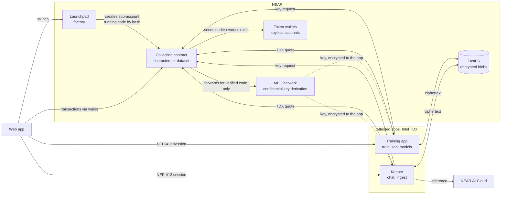
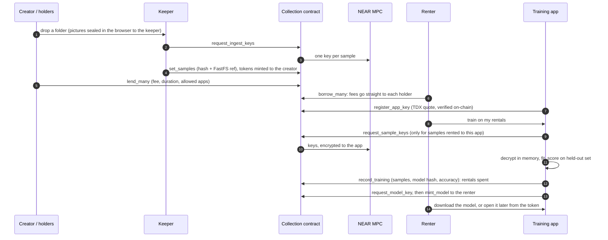

# Nearkat

**NFTs that carry private data only attested code can open.** The token's
contract decides who gets the decryption key, NEAR's MPC network derives it,
and the data itself sits encrypted on NEAR. It started as a pet with a private
memory. The same mechanism now runs a launchpad, encrypted training datasets
whose samples earn rent, and trained models that are tokens themselves: the
first pieces of a decentralized Hugging Face.

| | |
| --- | --- |
| Hackathon | NEAR Hackathon 2026, tracks **Privacy & Private AI** and **NFTs That Do Something** |
| Live demo (testnet) | <https://web-production-bffc5.up.railway.app/?demo=hotdogs.pad.pals-c0b7a5.testnet> |
| Contracts (testnet) | launchpad `pad.pals-c0b7a5.testnet`, dataset `hotdogs.pad.pals-c0b7a5.testnet`, characters `nft2.pals-c0b7a5.testnet` |
| Try it without a wallet | [Check the live deployment from a terminal](#1-check-the-live-deployment-from-a-terminal-no-wallet) |
| Run everything locally | [Run the whole thing locally](#3-run-the-whole-thing-locally) |
| What is and isn't proven | [Limits](#limits) |

Contents: [The story](#the-story) · [The idea](#the-idea) · [Try it](#try-it) ·
[How it works](#how-it-works) · [NEAR techniques](#near-techniques-used) ·
[Applications](#applications-toward-a-decentralized-hugging-face) ·
[Site map](#site-map) · [Code map](#code-map-a-guide-for-agents) ·
[Feature → evidence](#feature--evidence) · [Limits](#limits) ·
[Hackathon disclosure](#hackathon-disclosure)

## The story

It began as a Tamagotchi. A *nearkat* is an NFT with a mind: you raise it by
talking to it, it grows where everyone can see, and when you give it away its
memories go with it. Making that honest forced one hard question: **where does
a token's private memory live, and who holds the key?** If the answer is "our
server", the NFT is a receipt for a database row.

Answering it properly produced a mechanism that had nothing to do with pets:

| When | What was built | What it turned out to be |
| --- | --- | --- |
| 13–14 Oct (before the hackathon) | One contract, a local keeper, a web app: mint a kat, talk to it, give it away | A pet whose memory is an encrypted blob with its hash on-chain |
| 21–22 Oct | The launchpad: anyone launches a collection with its own prompt, as a sub-account running code published once by hash. The contract verifies a keeper's TDX quote itself | Not a pet. A *kind of token with a private mind*: tutors, game masters, recommenders |
| 27 Oct | Keys from NEAR's MPC network, storage on NEAR (FastFS), key epochs and keeper hand-over | The contract, not an operator, decides who can open a token's data. Keepers become replaceable |
| 28 Oct | A wallet for every token: a keyless account only its collection can send from | Tokens that hold and spend money under their owner's rules |
| 30 Oct | Lending, free or for a fee; teaching a token from your own chat history, sealed in the browser | Access to private data can be *priced and time-limited* without moving the token |
| 7 Nov | Layered art drawn from each token's id and on-chain growth; first hosted testnet deployment | Every token looks different, and its growth is public while its memory is not |
| 9–10 Nov | Dataset collections: every token is one encrypted training sample; holders rent samples to an attested training app | The private thing no longer has to be a mind. It can be **data someone wants to train on** |
| 14 Nov | The trained model is minted as a token of the dataset, sealed the same way; live run on testnet | Datasets and models are both tokens, with provenance between them on-chain |

So the pet is still here, and it is still the friendliest way in. But what the
project is now: **a way to put private data and the models trained on it
on-chain as assets, where the people who contributed the data are paid each
time it is used, and nobody, including the person paying, sees it.** (That
last part holds when the services run inside a TEE. The code for that is built
and tested; the live demo does not run in one yet. See [Limits](#limits).)

## The idea

One mechanism, used three times.

1. **Data is encrypted and stored on NEAR.** Each blob is a FastFS file
   addressed to the collection; the contract records its SHA-256.
2. **The key comes from NEAR's MPC network, and only the collection's contract
   can ask for it.** Confidential key derivation (CKD) derives a key bound to
   the *calling account*. The collection is the only account that can ask for
   its keys, so its code is the access policy.
3. **The contract forwards a key request only for code it has verified.** A
   service proves it runs inside a specific Intel TDX app by submitting a
   quote, which the contract verifies itself. The key comes back encrypted to
   a throwaway key made inside that app. (A collection launched without a TEE
   requirement lets its admin trust a service's key by hand instead. The live
   demo runs that way.)

| Token | What is sealed | Who the contract releases the key to |
| --- | --- | --- |
| A character (a kat, a tutor) | Its character and memory | The collection's keeper, to serve the token's current owner or borrower |
| A dataset sample | One labelled image | The keeper once, to seal it; after that only a training app the sample is *currently rented to* |
| A model | The weights a run learned | Only the training app that recorded that run, to open it for the token's current owner |

What follows from it:

- **No custodian.** No service's own secret opens anything. A collection can
  name a new keeper and it derives the same keys; rotating the key epoch locks
  the old keeper out of everything saved afterwards.
- **Ownership is access.** Transfer the token and the right to open its data
  moves with it, at once, with nothing handed over off-chain.
- **Access can be rented without moving the token.** A loan is a record in the
  contract. For samples it names the training apps allowed, is paid per sample
  straight to the holder, and is spent by one training run.
- **Provenance is on-chain.** A run records which samples it used, which app
  ran it, who paid, the model file's hash and its held-out accuracy.

## Try it

### 1. Check the live deployment from a terminal (no wallet)

Every claim below is a view call against NEAR testnet.

```bash
view() {  # view <account> <method> '<json args>'
  curl -s https://rpc.testnet.fastnear.com -H 'content-type: application/json' -d "{
    \"jsonrpc\":\"2.0\",\"id\":1,\"method\":\"query\",\"params\":{\"request_type\":\"call_function\",
    \"finality\":\"final\",\"account_id\":\"$1\",\"method_name\":\"$2\",
    \"args_base64\":\"$(printf '%s' "$3" | base64 | tr -d '\n')\"}}" |
  python3 -c 'import sys,json; print(bytes(json.load(sys.stdin)["result"]["result"]).decode())'
}
DS=hotdogs.pad.pals-c0b7a5.testnet
```

| Do | See |
| --- | --- |
| `view pad.pals-c0b7a5.testnet get_collections '{}'` | The launchpad lists `hotdogs.pad…` as live, with the code hash every collection runs |
| `view $DS get_collection '{}'` | `"kind":{"Dataset":{"classes":["hotdog","not_hotdog"]}}`, `"class_counts":["100","100"]`, `"minted":"200"`, and `key_source` naming `v1.signer-prod.testnet` (NEAR's MPC contract) |
| `view $DS get_sample '{"token_id":"1"}'` | A sample is an owner, a hash and a `fastfs:` reference. No image, no label |
| `view $DS get_loan '{"token_id":"1"}'` | The rental that paid its holder 0.01 NEAR, now `over` because a run spent it |
| `view $DS training_apps '{}'` | The training app holders can rent to: `svm-mobilenet-v1` |
| `view $DS get_models '{"from":0,"limit":5}'` | Models minted as tokens: `model-run-fe3b331b5679`, trained on 150 samples, `accuracy_bps: 8800`, with the model file's SHA-256 and the sealed blob's FastFS reference |
| `curl -s https://keeper-production-e90d.up.railway.app/collections` | The keeper serves both the character collection and the dataset |
| `curl -s https://trainer-production-25ff08f2.up.railway.app/info` | The training app, its id and its 50 held-out images |

The same accounts in an explorer:
[launchpad](https://testnet.nearblocks.io/address/pad.pals-c0b7a5.testnet) ·
[dataset](https://testnet.nearblocks.io/address/hotdogs.pad.pals-c0b7a5.testnet) ·
[characters](https://testnet.nearblocks.io/address/nft2.pals-c0b7a5.testnet).

### 2. In the browser (testnet wallet with about 2 NEAR)

Open <https://web-production-bffc5.up.railway.app/?demo=hotdogs.pad.pals-c0b7a5.testnet>.
The `?demo=` part adds a guide bar that walks through these steps.

| Do | See |
| --- | --- |
| Open **Collections** | The home character collection and every launch, including the Hotdogs dataset |
| Open the Hotdogs collection | 200 samples as sealed tiles: class counts, no picture anywhere |
| Open a model under **Models** | Its run from the chain: samples used, accuracy, the model file's hash. No weights |
| Connect a wallet. In **Rent samples** pick the app, enter 2 or more, press Rent | One wallet confirmation; each holder is paid 0.01 NEAR per sample in the same transaction |
| Press **Train on N rented samples** | Stages appear live: rentals checked, keys fetched from the MPC network, samples loaded, trained, recorded on-chain |
| When it finishes | Held-out accuracy, the on-chain record, a **Download model** button (an ONNX file, about 12 MB), and a model token minted to you |
| Drop a photo under **Try it** | "hotdog" or "not hotdog", computed in your browser |
| Open your model token and press **Open the model** | The training app checks you own it, gets its key, rebuilds the file; the page checks its hash against the chain |
| On the home page, **Mint a kat**, then talk to it | A character that answers, costs 0.002 NEAR a message from its own balance, and saves what it learned |
| **Verify this kat** | Your browser recomputes the mind's hash and matches it to the contract, and checks the model provider's signature on the last reply |

Each sample can be trained on once per rental, so the 50 samples on offer at
the time of writing run down as people try it. With too few left, use the
local run below.

### 3. Run the whole thing locally

Needs Node 24, Rust with `cargo near` 0.22+, `uv` with Python 3.12, and Chromium
for Playwright (`npx playwright install chromium`). Everything runs against a
local NEAR sandbox and a stand-in MPC contract that does the real key maths;
no accounts or API keys are needed.

```bash
# The demo dataset (pinned commit, never committed) and the trainer's backbone weights
scripts/fetch-hotdog.sh
(cd trainer/py && uv run python fetch_weights.py)

# Contracts
(cd contract     && cargo near build non-reproducible-wasm)
(cd launchpad    && cargo near build non-reproducible-wasm)
(cd token-wallet && cargo near build non-reproducible-wasm --no-abi)
(cd mock-mpc     && cargo near build non-reproducible-wasm --no-abi)

# Services
(cd keeper && npm install) && (cd trainer && npm install) && (cd web && npm install)
```

| Do | See |
| --- | --- |
| `cd web && npm run e2e` | 7 browser stories pass (about 4 minutes): mint, raise and give away a kat; lend it; launch a collection; launch a dataset from a dropped folder; rent, train, download and try a model |
| `cd web && REHEARSAL=1 npx playwright test rehearsal` | The stage demo at full size (about 6 minutes): 200 real images launched, 150 rented, a model trained, about 88% on 50 held-out images scored in the browser, each step timed in the output |
| `cd contract && cargo test` | Unit tests, then sandbox tests against the compiled wasm, including a real TDX quote verified on-chain |
| `cd keeper && npm test`, `cd trainer && npm test`, `cd web && npm test` | Unit and integration suites |
| `cd trainer/py && uv run pytest` | The trainer, including that the exported ONNX file predicts what the fitted model does |

To run the services by hand instead, copy each `.env.example` to `.env`, then
`npm run dev` in `keeper/` (:8787), `trainer/` (:8790) and `web/` (:3000).
Configuration is in each package's README.

## How it works



### A character (a kat)

1. Minting gives the token a balance. The keeper writes its starter character,
   encrypts it, stores it on FastFS and records the hash on the token.
2. The owner signs in with their wallet (NEP-413) and chats. The keeper checks
   ownership on-chain for every request, decrypts the mind, calls a model on
   NEAR AI Cloud, and charges the token's own balance.
3. After enough conversation the keeper folds what mattered into the
   character and memory and saves a new version. The on-chain version number
   drives the token's art, so growth is public while the memory is private.
4. Transfer the token and the next owner gets the same mind. The previous
   owner is refused from that block on.

### A dataset and a model



The model is a linear SVM on frozen MobileNetV3-Large features, fitted on a
CPU in seconds and exported as one ONNX file that runs in the browser. On the
live testnet run, fetching 150 keys and loading the samples took about a
minute, and training, recording and minting about 40 seconds. Details:
`trainer/README.md`.

## NEAR techniques used

| Technique | What it does here | Where |
| --- | --- | --- |
| **MPC confidential key derivation** (`request_app_private_key` on `v1.signer`) | Derives each collection's, sample's and model's key for the *collection's account*, returned encrypted to a throwaway BLS12-381 key. The keeper and trainer verify the answer with a pairing check | `contract/src/ckd.rs`, `keeper/src/ckd.ts`, `mock-mpc/` |
| **Contract as key gate** | Only the collection can ask the MPC network for its keys, and it forwards a request only for its keeper, or for an app a sample is rented to, called directly (not through a relay contract) | `contract/src/dataset.rs`, `contract/src/apps.rs` |
| **TDX attestation verified on-chain** | The contract checks an Intel TDX quote (dcap-qvl, about 166 Tgas), that it commits to the app's keys, and that dstack's event log replays to RTMR3 and names the required app | `contract/src/attestation.rs` |
| **Global contracts** (code published once, used by hash) | Every launched collection and every token wallet runs shared code referenced by hash; upgrades move to another approved hash and run `migrate` in the same batch | `launchpad/src/lib.rs`, `contract/src/upgrade.rs` |
| **Sub-account factory** | `launch` creates `<slug>.<launchpad>`, initialises it, and refunds the creator if any step fails | `launchpad/src/lib.rs` |
| **Keyless accounts as token wallets** | Each token can own `<token_id>.<collection>`: an account with no access keys whose only method obeys the collection contract, which applies the owner's spending rules. The wallet moves with the token | `contract/src/wallet.rs`, `token-wallet/` |
| **Promise fan-out with callbacks** | One call requests up to 10 keys from the MPC network in parallel and collects them in a callback; minting 200 samples continues across receipts and anyone can finish it | `contract/src/dataset.rs` |
| **FastFS** (`__fastdata_fastfs`) | Encrypted blobs are stored as transaction data addressed to the collection, read back from a gateway or any archival node and checked against the on-chain hash | `keeper/src/fastfs.ts`, `keeper/src/store.ts` |
| **NEP-171 / 177 / 178 / 181** | Core, metadata, approvals and enumeration, so tokens show in wallets and marketplaces | `contract/src/nft.rs` |
| **NEP-199 payouts** | Creator royalties on resale | `contract/src/payout.rs` |
| **NEP-297 events** | `loan_offered`, `loan_started`, `model_minted`, `wallet_payment` and others, sized to stay under the 16 KB log limit for 50-sample batches | `contract/src/lending.rs` |
| **NEP-413 message signing** | Wallet sign-in to the keeper and to each training app, each with its own recipient so a session for one opens nothing at another | `keeper/src/auth.ts`, `web/src/lib/session.ts` |
| **Multi-action transactions** | Renting 150 samples from three holders is one wallet confirmation | `web/src/lib/contract.ts` |
| **Storage staking, paid by whoever causes it** | Lenders, renters and minters attach the storage their records need; surplus is refunded | `contract/src/lending.rs`, `contract/src/dataset.rs` |
| **NEAR AI Cloud** | Inference for characters; the browser checks the provider's signature on each reply | `keeper/src/inference.ts`, `web/src/lib/verify.ts` |
| **NEAR Connect** | Browser wallets on testnet and mainnet | `web/src/wallet/` |

## Applications: toward a decentralized Hugging Face

Hugging Face is a place to publish datasets and models. What it cannot do is
let you contribute data you would never publish, get paid when it is used, and
know what it was used for. That is what this adds.

| On a model hub | Here | Built? |
| --- | --- | --- |
| A dataset repository | A dataset collection; every sample is a token its contributor holds | Yes |
| Gated access: a form and trust | The contract releases a sample's key only to an attested app it is rented to | Yes on-chain; live runs so far use local mode, see [Limits](#limits) |
| Free use, no payment to contributors | A fee per sample per run, paid in the renting transaction to each holder | Yes |
| A training job on someone's servers | A training app whose code identity the contract verified; different parties can run different apps on the same data | Yes; one app so far |
| A model repository | A model token, sealed, that opens only for its owner and can be sold or given away | Yes |
| A model card someone wrote | An on-chain record: which samples, which app, who paid, file hash, held-out accuracy | Yes |
| Search, versions, larger models, GPUs, hosted inference | | Not yet |

Uses the same contract already supports, or needs only a new training app for:

- **Data unions.** Photographers, clinics or labs each hold their own samples
  and earn per use, without a middleman holding the data.
- **Training on data that can't be shared.** Medical images, private
  documents, proprietary corpora: the renter gets a model, never the data.
- **Auditable AI.** A model whose training set, trainer and score are on-chain
  can answer "what was this trained on, and did they pay for it?"
- **Models as assets.** A fine-tune that can be sold, given or held by a DAO,
  with the weights opening only for the current owner.
- **Agents with a memory and a budget.** A character with a private memory
  that travels with ownership and a wallet it can spend from within limits:
  tutors, companions, game masters, personal recommenders taught from your
  own chat history.

## Site map

The web app is a static single-page app (`web/`). It reads contracts directly,
sends transactions through the visitor's wallet, and talks to the keeper and
training apps for anything that touches sealed data.

| Path | What it shows | Source |
| --- | --- | --- |
| `/` | What a nearkat is, minting, the kats in your wallet | `web/src/pages/Home.tsx` |
| `/kat/:id` | Talk to a kat; its character, memory, growth, balance, wallet; lend it; give it away | `web/src/pages/Kat.tsx` |
| `/kat/:id/verify` | What the browser can check: the mind's hash against the chain, where it is stored, the reply's signature, the keeper's TDX quote | `web/src/pages/Verify.tsx` |
| `/collections` | The home collection and every launch | `web/src/pages/Collections.tsx` |
| `/launch` | Launch a collection: a character from a template (Character, Tutor, Game master, Private recommender) or a **Dataset** from a dropped folder | `web/src/pages/Launch.tsx` |
| `/c/:contract` | A collection. Characters: prompt, terms, who can open minds, mint. Datasets: sealed samples, **List your samples**, **Rent samples**, **Train a model**, **Models** | `web/src/pages/Collection.tsx` |
| `/c/:contract/kat/:id` | A token of a launched collection; for a dataset, one sample's rentals and runs | `web/src/pages/Kat.tsx`, `web/src/components/SamplePanel.tsx` |
| `/c/:contract/kat/model-:run` | A model token: its run and hashes from the chain and, for its owner, the model opened and tried | `web/src/components/ModelPanel.tsx` |
| `/c/:contract/kat/:id/verify` | Verification for a launched collection's token | `web/src/pages/Verify.tsx` |
| `?demo=<dataset>` on any path | A guide bar that steps through the demo | `web/src/components/DemoGuide.tsx` |

Service endpoints are listed in `keeper/README.md` (chat, context, ingest,
art, attestation) and `trainer/README.md` (train, runs, models, attestation).

## Code map: a guide for agents

Each package has its own README with methods, routes and environment
variables. Design documents are in `docs/superpowers/specs/`, one per stage of
the story above; the dataset design is
`docs/superpowers/specs/2026-11-09-dataset-collections-design.md`.

| Path | Language | What it is |
| --- | --- | --- |
| `contract/` | Rust, near-sdk | The collection contract. One codebase serves character and dataset collections |
| `launchpad/` | Rust | The factory that launches collections as sub-accounts |
| `token-wallet/` | Rust | The code every token's own account runs: one method, callable only by its collection |
| `mock-mpc/` | Rust | Stand-in for NEAR's MPC contract with the real BLS12-381 maths, for sandbox tests |
| `keeper/` | TypeScript, Node 24, hono | The service that opens characters' minds and seals dataset samples |
| `trainer/` | TypeScript + Python | The training app: `src/` is the service, `py/` fits and exports the model |
| `web/` | React 19, Vite | The web app and the Playwright end-to-end stories |
| `art/` | TypeScript | Token art as SVG, drawn from the token id and its on-chain growth; shared by web and keeper |
| `scripts/` | Shell, TypeScript | `fetch-hotdog.sh` (the demo dataset), `demo-hotdog.ts` (spread and list samples, rent from the command line) |
| `deploy/` | Docker | Images for keeper, trainer and web; `phala/` compose files |
| `docs/demo/` | Markdown | `walkthrough.md` (characters and launchpad), `hotdog.md` (dataset stage script), `phala.md` (TEE deployment plan) |

Where to start reading, by question:

| Question | Read |
| --- | --- |
| Who can get a key, and when? | `contract/src/ckd.rs` (forwarding to the MPC network), `contract/src/dataset.rs` (`request_ingest_keys`, `request_sample_keys`, `request_model_key`), `contract/src/keeper.rs` |
| How is a TEE proven to the chain? | `contract/src/attestation.rs`, `contract/src/apps.rs` (`register_app_key`), fixtures in `contract/tests/fixtures/` |
| How do rentals work? | `contract/src/lending.rs` (`lend`, `borrow`, `lend_many`, `borrow_many`, `end_loan`) |
| How does a model become a token? | `contract/src/dataset.rs` (`record_training`, `mint_model`), `trainer/src/model.ts`, `trainer/py/assemble.py` |
| How does a token own a wallet? | `contract/src/wallet.rs`, `token-wallet/src/lib.rs`, `keeper/src/wallet.ts` |
| How is a collection launched and upgraded? | `launchpad/src/lib.rs`, `contract/src/upgrade.rs` |
| How is an MPC answer checked and turned into keys? | `keeper/src/ckd.ts` (tested against vectors from NEAR's MPC repository in `keeper/test/ckd.test.ts`) |
| How is a sample sealed and stored? | `web/src/lib/samples.ts` (browser), `keeper/src/ingest.ts`, `keeper/src/samples.ts`, `keeper/src/fastfs.ts` |
| What does a training run do, step by step? | `trainer/src/run.ts`, then `trainer/py/train.py` |
| How does a character think, save and grow? | `keeper/src/kats.ts`, `keeper/src/context.ts`, `keeper/src/inference.ts` |
| What can a browser verify by itself? | `web/src/lib/verify.ts`, `web/src/lib/tdx.ts`, `web/src/lib/model.ts` |
| What does the whole flow look like in one file? | `web/e2e/train.spec.ts` (dataset) and `web/e2e/kat.spec.ts` (characters) |
| How is the local stack wired together? | `web/e2e/global-setup.ts` |

Conventions: contract state added after launch lives under its own raw storage
keys, so older collections need no migration. TypeScript runs directly on
Node 24 with no build step. Lint is `biome`, tests are `vitest`, `cargo test`
and `pytest`. Deployable wasm is built without the embedded ABI.

## Feature → evidence

| Claim | Test that shows it | Run |
| --- | --- | --- |
| A sample's key goes only to the app it is rented to, and not after the run has spent the rental | `a_sample_opens_only_for_the_app_it_was_rented_to` | `cd contract && cargo test` |
| A relay contract can't request keys on an app's behalf | the `Call this directly, not through another contract` tests in `contract/src/tests.rs` | `cd contract && cargo test` |
| A real Intel TDX quote verifies on-chain within the gas limit | `a_real_tdx_quote_verifies_on_chain_within_the_gas_limit` | `cd contract && cargo test` |
| The keeper gets a collection's key from the MPC network only through the collection | `the_keeper_gets_the_context_key_from_the_mpc_network_through_the_collection` | `cd contract && cargo test` |
| A token's wallet pays under its owner's rules and moves with the token | `a_tokens_own_wallet_pays_under_its_owners_rules_and_goes_with_it_at_once` | `cd contract && cargo test` |
| A rented token pays its owner and comes back when time is up | `a_token_rented_out_pays_its_owner_and_comes_back_when_its_time_is_up` | `cd contract && cargo test` |
| A mind and its balance follow the token; the previous owner is locked out | `personality_and_balance_follow_the_kat_on_transfer`, `previous_owner_cannot_transfer_back` | `cd contract && cargo test` |
| Old collections upgrade to new code and keep their tokens | `a_collection_from_before_key_epochs_upgrades_and_keeps_its_tokens` | `cd contract && cargo test` |
| A creator launches a dataset and its samples finish minting | `a_creator_launches_a_dataset_and_finishes_minting_its_samples` | `cd launchpad && cargo test` |
| A failed launch refunds the creator | `a_failed_launch_refunds_the_creator_and_frees_the_name` | `cd launchpad && cargo test` |
| MPC answers are verified and keys derived as NEAR's MPC specifies | `keeper/test/ckd.test.ts`, `keeper/test/integration-ckd.test.ts` | `cd keeper && npm test` |
| Drop a folder, get an encrypted dataset on-chain | `web/e2e/launch.spec.ts` | `cd web && npm run e2e` |
| Rent, train, record, download, classify in the browser | `web/e2e/train.spec.ts` | `cd web && npm run e2e` |
| The same at 200 samples, with timings and accuracy | `web/e2e/rehearsal.spec.ts` | `cd web && REHEARSAL=1 npx playwright test rehearsal` |
| Mint, raise, lend and give away a character | `web/e2e/kat.spec.ts` | `cd web && npm run e2e` |
| The exported ONNX file predicts what the fitted model predicts | `trainer/py/test_train.py` | `cd trainer/py && uv run pytest` |
| It runs on real testnet infrastructure | `get_models` in [Try it](#1-check-the-live-deployment-from-a-terminal-no-wallet) | the `view` calls above |

Test counts on 14 Nov, all passing: contract 269 unit and 13 sandbox;
launchpad 30 and 4; token wallet 3; keeper 400; trainer 94 (TypeScript) and
18 (Python); web 356.

## Testnet deployment

| What | Where |
| --- | --- |
| Launchpad | `pad.pals-c0b7a5.testnet` |
| Dataset collection (200 samples, 3 holders) | `hotdogs.pad.pals-c0b7a5.testnet` |
| Character collection ("Pocket Pals") | `nft2.pals-c0b7a5.testnet` |
| MPC contract and CKD domain | `v1.signer-prod.testnet`, domain 2 |
| Collection code (global contract, by hash) | `B9is8Cdgiw6WyXsYApbhzb7G414UaS6UNduFfawr29bF` |
| Token wallet code (global contract, by hash) | `BJU31NAqbL5HNJmvcP5dXCrWvD3zgVykw2b5KM8EBMAT` |
| Keeper | <https://keeper-production-e90d.up.railway.app> (`keeper.pals-c0b7a5.testnet`) |
| Training app `svm-mobilenet-v1` | <https://trainer-production-25ff08f2.up.railway.app> (`trainer.pals-c0b7a5.testnet`) |
| Web app | <https://web-production-bffc5.up.railway.app> |

The first live run (14 Nov): 150 samples rented from three holders in one
transaction, a model trained to 88% on the held-out set, recorded, minted as
`model-run-fe3b331b5679` and opened again from the token. The services run in
**local mode** on ordinary hosting, not in a TEE: see the first limit below.

## Limits

Stated plainly, because the value of this design is in what it guarantees and
a reader should know which guarantees have been exercised.

- **The live deployment is not private yet.** The keeper and trainer run in
  local mode (`KEEPER_MODE=local`, `TRAINER_MODE=local`): the root secret
  comes from the environment and the operator could read what the service
  decrypts. The TEE path is built and tested (the contract verifies a real TDX
  quote in its sandbox tests, and both services have a `phala` mode that takes
  their secret from dstack's key service), but nothing has been deployed to
  Phala. `docs/demo/phala.md` is the plan for that, not a record of it.
- **A rental's single use relies on the attested code.** The chain controls
  who gets a key and when. It cannot control what an app does once it has one.
  A sample is used once because the attested training code discards keys after
  a run, which is why collections name specific app identities.
- **Samples are public and permanent.** They are on FastFS: encrypted, but
  undeletable. Privacy rests on the keys; if a key leaks or the cryptography
  is broken, the data cannot be withdrawn.
- **Trained models can leak.** A model can reveal something about its training
  data (memorisation, membership inference). The renter receives a model, not
  the samples, which is not the same as no leakage.
- **A model token seals the model at rest, not from its owner.** The owner
  receives the file and can copy it, so a later owner cannot know earlier
  owners kept none. The sealed part is the classifier the run learned; the
  backbone is the public MobileNetV3-Large, named by its hash.
- **A model token's file is rebuilt from the sealed weights and the backbone.**
  The same image rebuilds it byte for byte. An app updated to other library
  versions may not, and then refuses to hand it out.
- **Secret instructions are hidden, not guaranteed secret.** The keeper
  replaces replies that quote a collection's sealed prompt; a model can still
  be talked into paraphrasing.
- **The reply signature shows who signed, not where.** The browser checks the
  inference provider's signature; tying that key to hardware needs the
  provider's attestation report.
- **Stand-ins in tests.** Most tests use a local sandbox and a mock MPC
  contract that does the real key maths. The key derivation is also checked
  against testnet's MPC (`npm run live-check` in `keeper/`), and the dataset
  flow has run end to end on testnet.
- **Scale.** The demo model is small and trains on a CPU. Launches are capped
  at 1,000 samples and 96 KB per image. The renter-side scan reads the first
  200 samples of a collection.
- **The demo dataset is AGPL-3.0.** The hotdog images are
  `truepositive/hotdog_nothotdog`, fetched at a pinned commit by
  `scripts/fetch-hotdog.sh` and never committed. The trainer and web images
  contain the held-out images, so distributing those images distributes them
  under the AGPL.
- **Browser wallets.** Signing goes through NEAR Connect. Wallets beyond the
  ones used in the live run have not been tried by hand.

## Hackathon disclosure

- **Code from before the hackathon.** Commits up to `6c56e75` (14 Oct 2026,
  tag `pre-hackathon`) predate the 19 Oct announcement: a single NFT contract,
  a local keeper with its own secret, and the first web app (mint a kat, talk
  to it, give it away). Everything else was built in the window: the
  launchpad, MPC key derivation, on-chain TDX verification, FastFS storage,
  token wallets, lending and rentals, history import, the art, dataset
  collections, the training app and model tokens.
  Diff: `git diff pre-hackathon..main`
  (<https://github.com/dawgster/nearkat-launchpad/compare/pre-hackathon...main>).
- **NEAR integration.** Listed in [NEAR techniques used](#near-techniques-used).
  Testnet only.
- **Libraries.**
  Contracts: `near-sdk` 5.29, `near-contract-standards`, `dcap-qvl` (TDX quote
  verification), `sha2`; tests use `near-sandbox`, `near-api`, `bls12_381`.
  Services: `hono`, `near-kit`, `@noble/curves`, `@noble/hashes`,
  `@phala/dcap-qvl`.
  Trainer: `torch`, `torchvision` (MobileNetV3-Large ImageNet weights),
  `scikit-learn`, `onnx`.
  Web: `react`, `react-router`, `vite`, `tailwindcss`, `near-kit`,
  `@hot-labs/near-connect`, `onnxruntime-web`, `fflate`; tests use `vitest`
  and `playwright`.
  No project template was used.
- **External services.** NEAR's MPC network, NEAR AI Cloud (inference), FastFS,
  and, in the TEE design, Phala Cloud / dstack on Intel TDX.
- **AI assistance.** Much of the code was written with Claude Code; commit
  trailers say where.
